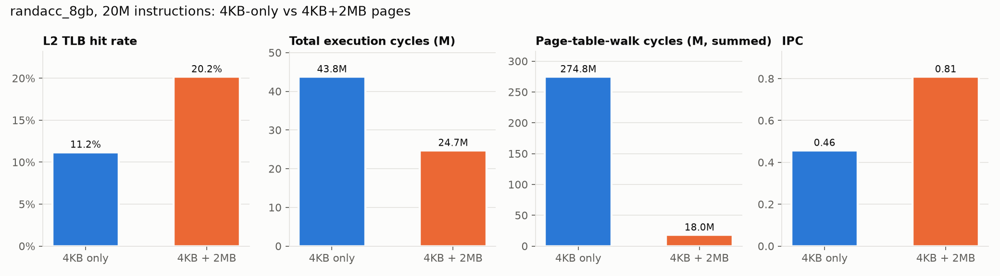
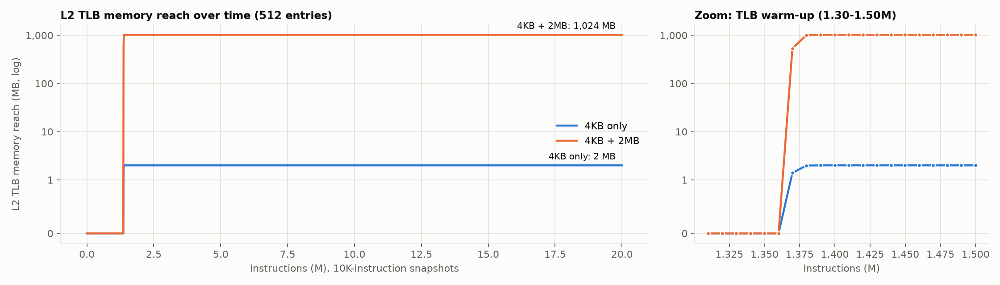
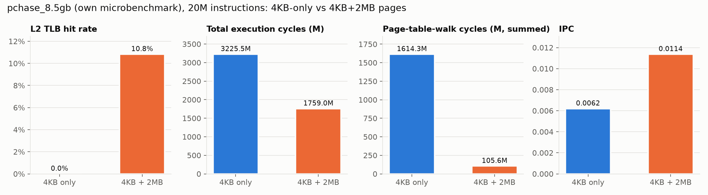
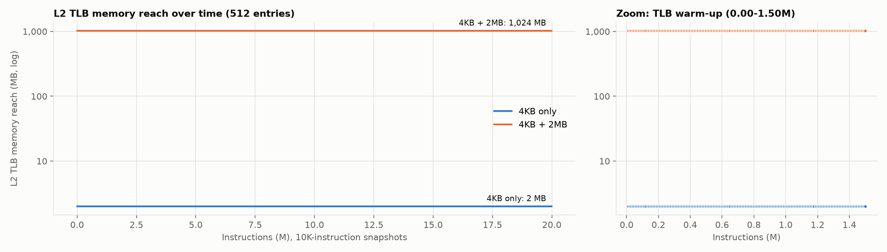
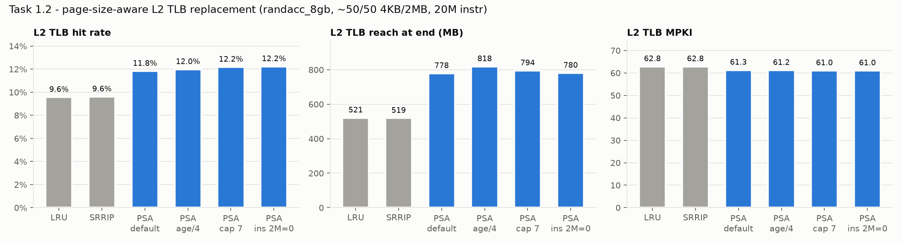
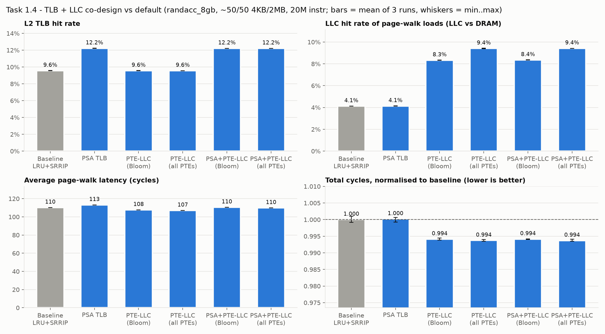
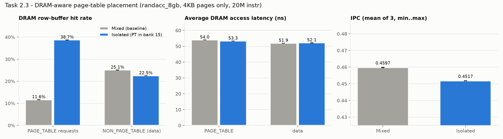
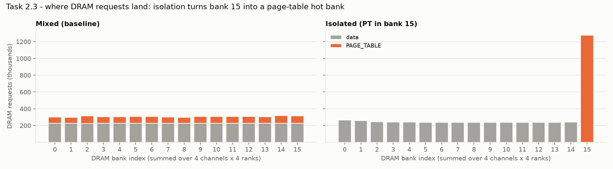
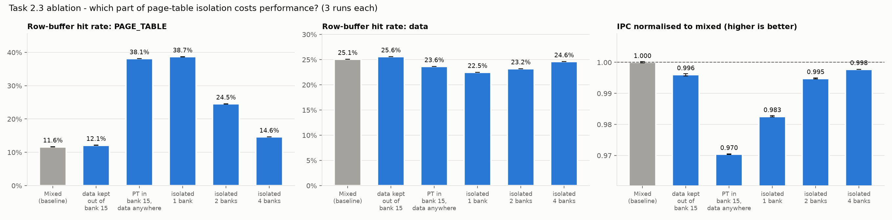

# Lab 6 report: Advanced Virtual Memory Features

ETH Zürich Computer Architecture, Fall 2025, Bonus Lab 6. Simulator: Virtuoso + Sniper, lab branch `comp_arch_lab6_2025`.

All main experiments use the provided trace `traces/randacc_8gb.sift` (random accesses over an 8 GB array); Task 1.1
additionally uses my own pointer-chase microbenchmark (`pchase_8.5gb`), which is also used to cross-check Tasks 1.4 and 2.3.
All runs simulate
20M instructions on the baseline system (`virtuoso_reservethp.cfg` / `virtuoso_pagetable_aware.cfg`: 48 GB memory,
16 GB user space, L1 TLB 64×4, L2 TLB 512×8, 2 MB 16-way LLC, DDR4-2400 with 4 channels × 4 ranks × 16 banks).

**Methodology note.** Sniper is not fully deterministic here: identical runs differ by up to ~0.6% in total cycles
(host-thread interleaving), while TLB / LLC / row-buffer counters differ by ~0.01%. All cycle and IPC comparisons in
Tasks 1.4 and 2.3 are therefore the **mean of 3 runs, with min..max ranges**. Single-run cycle differences below ~1%
are not meaningful.

Plots are in `results/plots/`, raw per-run stats in `results/<run>/sim.stats`, aggregated tables in `results/*.csv`.

---

## Task 1: Page-size-aware replacement policies

### 1.1 Impact of page sizes on address translation

**Workloads.** I ran two workloads: the provided `randacc_8gb` trace (below), and my own pointer-chase microbenchmark
(see *Own microbenchmark* at the end of this section). Decoding its hot loop from the trace (`sift/siftdump`) shows the HPCC RandomAccess
("GUPS") kernel:

```
mov  rcx,[rdx]               ; ran = buf[j]                (1 KB batch buffer on the stack)
lea  rax,[rcx+rcx]           ; \
xor  rsi,7 ; test ; cmovs    ;  } ran = (ran << 1) ^ (ran < 0 ? POLY : 0)   (LFSR)
mov  [rdx-8],rax             ; buf[j] = ran
and  rcx,rdi                 ; idx = ran & (N - 1)
xor  [r12+rcx*8],rax         ; Table[idx] ^= ran           <- 8 B read-modify-write
jne  ...                     ; 128 updates per batch
```

**Why it stresses the VM subsystem.**
- **Access pattern:** 12 instructions per update, i.e. ~83 random read-modify-writes per kilo-instruction.
- **Footprint:** the table is 2³⁰ × 8 B = 8 GB. The random-update instruction's addresses span exactly 8.00 GB.
  With 2 MB pages enabled, the OS backs 4,099 2 MB regions (≈8 GB) within 20M instructions.
- **No locality:** consecutive updates land on unrelated pages (296K distinct 4 KB pages in a 381K-update sample),
  so neither page-level nor row-level locality exists for the table.
- **TLB pressure:** L2 TLB MPKI is **70.2** with 4 KB pages and **59.1** with 2 MB pages, well above the required 10.
- **Cold page faults:** with 4 KB pages, the first 20M instructions are also dominated by first-touch page faults
  in the simulated OS (932K faults).

Configurations: `target_fragmentation = 0.0` (no 2 MB pages can be formed, so 4 KB only) versus `1.0` (4 KB + 2 MB
enabled; the reservation-based THP allocator then backs essentially the whole array with 2 MB pages: 4,099 promoted
regions).

| Metric (20M instructions) | 4 KB only | 4 KB + 2 MB |
|---|---|---|
| L2 TLB hit rate | 11.2% | 20.2% |
| L2 TLB MPKI | 70.2 | 59.1 |
| Total execution cycles | 43.8M | 24.7M (−44%) |
| Page-table-walk cycles (summed over all walks) | 274.8M | 18.0M (−93%) |
| Average cycles per walk | 196 | 15 |
| IPC | 0.457 | 0.809 |
| L2 TLB memory reach (steady state) | 2 MB | 1,024 MB |



**Memory reach time series.** I added three callback stats to the TLB (`memory_reach_kb`, `valid_entries_4k`,
`valid_entries_2m` in `tlb.cc`). They scan all valid entries whenever stats are sampled.

- **Sampling:** Sniper's `periodicins-stats` script snapshots them every **10,000 instructions**, the epoch size the
  handout's task text asks for.
- **Simulator detail:** Sniper's periodic-instruction hook fires only every 100,000 instructions by default, so the
  10K series also needs `-g --core/hook_periodic_ins/ins_global=10000`. Without it, the snapshots silently stay
  100K apart.
- **No perturbation:** finer sampling does not change the simulation. The run sampled every 10K matches the run
  sampled every 100K (24.734M vs 24.728M cycles).
- **100K version:** a series at 100K intervals, the interval the report bullet mentions, is in
  `results/plots/t11_reach_timeseries.png`.



**What the series shows.**
- **Before ~1.37M instructions:** the trace performs no translations, so reach is 0.
- **Warm-up:** the L2 TLB then fills within two 10K epochs, passing through 1.4 MB / 532 MB at 1.37M and
  2.0 MB / 1,012 MB at 1.38M.
- **Steady state:** reach stays at 512 × 4 KB = **2 MB** with 4 KB pages and 512 × 2 MB = **1 GB** once 2 MB pages
  are available. That is 512× more reach.
- **Why it is flat:** with uniformly random accesses the TLB always holds 512 recently used, mostly different
  pages, so reach does not change after warm-up.

**Analysis.**
- **Hit rate improves less than reach suggests.** 2 MB pages raise the hit rate only from 11% to 20%. Even 1 GB of reach
  covers just 1/8 of an 8 GB uniformly random footprint, so ~7/8 of accesses still miss.
- **The win comes from cheaper walks.** With 2 MB pages, a walk is one level shorter, and the remaining upper-level
  entries (2,048 PMD entries in total) stay in the page-walk caches and the cache hierarchy. A walk drops from 196 to
  15 cycles.
- **Total.** Cheaper walks plus fewer of them give a 44% reduction in total cycles.

#### Own microbenchmark: page-granular pointer chase (`pchase_8.5gb`)

**Design** (`virtuoso-lab/microbenchmark/microbench.cpp`, recorded with `record_microbench_trace.sh`):
- **Footprint:** 8.5 GiB, 2 MB aligned, with one 8-byte node per 4 KB page (2,228,224 pages). Each node sits at a hashed
  cache-line offset within its page, so the nodes spread over all cache sets.
- **Access order:** all nodes are linked into a single random cycle (Sattolo's algorithm). The chase therefore visits
  every page exactly once per lap, in random order, and the reuse distance of every page is 2.2M pages, far beyond
  any TLB.
- **No memory-level parallelism:** the region of interest is just `p = *p`. Each load's address is the previous load's
  value, so the full translation latency of every step is exposed.
- **Trace:** 30M instructions recorded with Intel SDE (`--roi`, so only the chase is recorded), of which 20M are simulated. That is
  ~2.5 instructions per step, about 8M steps, or 3.6 laps over the array.

Same configurations as for randacc (frag 0.0 vs 1.0), 20M instructions:

| Metric (20M instructions) | 4 KB only | 4 KB + 2 MB |
|---|---|---|
| L2 TLB hit rate | 0.0% | 10.8% |
| L2 TLB MPKI | 400 | 351 |
| Total execution cycles | 3,225.5M | 1,759.0M (−45%) |
| Page-table-walk cycles (summed) | 1,614.3M | 105.6M (−93%) |
| Average cycles per walk | 202 | 15 |
| IPC | 0.0062 | 0.0114 |
| L2 TLB memory reach (steady state) | 2 MB | 1,024 MB |
| Page faults | 2,228,224 | 4,352 |




**What it shows.**
- **Worst case by construction.** With 4 KB pages, every step misses the L2 TLB (hit rate 0.0%, MPKI 400 = one miss
  per step). This is the expected result, since no page is reused within 512 translations.
- **Hit rate matches reach.** With 2 MB pages the hit rate is 10.8%, close to the ratio of reach to footprint
  (1 GB / 8.5 GB = 11.8%). This confirms that hits now come only from coverage, not from locality.
- **Same mechanism as randacc.** Again the walk-cost reduction dominates: 202 → 15 cycles per walk, −93% walk cycles,
  and −45% total cycles. This is almost the same relative gain as randacc (−44%), even though the absolute IPC is
  ~70× lower because each step is a serialized DRAM access.
- **Reach is flat from the first sample.** Unlike randacc, which has 1.37M instructions of setup before the first
  translation, the trace starts directly in the chase. At one miss per ~2.5 instructions, 512 entries fill within
  ~1.3K instructions, inside the first 10K epoch.
- **Page faults.** All 2.23M first touches occur inside the window (4 KB) versus 4,352 2 MB faults. This adds to the
  4 KB configuration's cycles in the same way as for randacc.

### 1.2 Page-size-aware L2 TLB replacement

**Page-size mix.** The allocator's `target_fragmentation` is the fraction of free memory left in ≥2 MB blocks.

| frag | 2 MB regions | 4 KB pages (in 20M instr) | L2 TLB hit (LRU) |
|---|---|---|---|
| 0.15 | 1,228 | 650K | 8.0% |
| **0.25** | **2,048** | **462K** | **9.6%** |
| 0.35 | 2,867 | 277K | 12.7% |
| 0.50 | 4,096 | 4.7K | 20.1% |

- **Choice:** I use **0.25**. Its 2,048 2 MB regions cover exactly 4 GB, i.e. half of the 8 GB table, so in steady
  state half the footprint is mapped with each page size. That setting is in `virtuoso_tlb_replacement.cfg`.
- **Caveat:** within the 20M-instruction window, the 4 KB half is not fully touched yet (462K pages ≈ 1.8 GB). By
  memory *touched so far*, the split is ~69/31, and by *page count*, 4 KB pages vastly outnumber 2 MB ones.
  "50/50" here means 50/50 of the footprint, which is what determines how often an access needs each page size.

**Motivation.** With the 50/50 mix, the default LRU L2 TLB reaches only a **9.6%** hit rate. That is *lower* than
with 4 KB pages only (11.2%), because the stream of 4 KB misses keeps evicting 2 MB entries, each worth 512× the
reach.

**Policy: page-size-aware SRRIP** (`cache_set_tlb_template.cc`, selected with the new per-TLB
`replacement_policy = "tlb_template"` key read in `tlb.cc`):

- **Per-way state:** a 2-bit re-reference prediction value (RRPV; 0 = keep, 3 = evict) plus a small aging credit.
- **Insertion:** 4 KB entries insert at RRPV 2 (SRRIP's "long" interval). 2 MB entries insert at `insert_2m`
  (best: 0), i.e. as if just re-referenced.
- **Hit:** RRPV = 0.
- **Victim selection:** the first way at RRPV 3. While protection is active, a 4 KB way at 3 is preferred over a 2 MB
  way at 3.
- **Aging:** when no way is at 3, every 4 KB entry ages by 1, but a protected 2 MB entry ages only every
  `huge_aging_period` (2) rounds. A 2 MB entry is sticky, but if it is never re-referenced it still reaches RRPV 3
  and gets evicted, just more slowly.
- **Preventing starvation of 4 KB entries:** protection is disabled in any set that holds more than `max_huge_ways`
  (6 of 8) 2 MB entries. In such a set, 2 MB entries age at full speed and are preferred as victims, so 4 KB
  translations always keep at least 2 ways per set. Combined with the bounded aging, no entry type can monopolise
  a set.
- **Implementation detail:** Sniper picks the victim *before* the new entry is copied into the set, so the incoming
  page size is not yet known. The policy records the filled way and assigns its insertion RRPV on the next access to
  that set, once the page size is stored. This avoids changing the shared cache code.

| L2 TLB policy (frag 0.25) | Hit rate | MPKI | Reach at end | 2 MB hits | 4 KB hits |
|---|---|---|---|---|---|
| LRU (default) | 9.57% | 62.84 | 521 MB | 117.9K | 15.1K |
| SRRIP | 9.61% | 62.82 | 519 MB | 118.5K | 15.0K |
| PSA (insert_2m=1, age/2, cap 6) | 11.82% | 61.27 | 778 MB | 150.5K | 13.8K |
| PSA, 2 MB ages at 1/4 speed | 11.97% | 61.17 | 818 MB | 153.0K | 13.5K |
| PSA, cap 7 ways | 12.18% | 61.03 | 794 MB | 155.7K | 13.6K |
| **PSA, insert_2m = 0 (chosen)** | **12.22%** | **61.00** | 780 MB | 156.3K | 13.6K |



**Results.**
- **TLB metrics:** the policy raises the L2 TLB hit rate by 28% relative to LRU (9.6% → 12.2%) and memory reach by
  ~50%.
- **Cost to 4 KB entries:** 4 KB hits fall by only ~10%, while 2 MB hits rise by 32%. 4 KB entries are not starved.

### 1.3 Co-designed PTE-aware LLC replacement

**Identifying PTEs whose translation is missing from the TLB.** A small Bloom filter (`cache/pte_priority_hint.cc`)
records every translation evicted from the last TLB level. It is fed in `mmu.cc` right after the TLB fill loop.

- **Key:** VPN plus page size.
- **Structure:** two banks of 64 Kbit (16 KB total), 2 hash functions.
- **Rotation:** the banks rotate every 4,096 insertions, with the older bank cleared, so "recently evicted" means
  within the last 1–2 epochs and the filter never saturates.
- **Hint:** when the page-table walker starts a walk for a VA that hits in the filter, the translation was useful
  enough to be cached before and is currently *not* in the TLB. The walk's PTE requests then carry a one-bit
  priority hint.
- **How the hint travels:** it is tied to the request *address*. The walker records the PTE cache lines a hinted
  walk requests (`mmu_base.cc`). When such a line is filled into the LLC, `NucaCache::write` looks it up and hands
  the bit to the replacement policy for that exact insertion.
- **Why not a global flag:** a first version used a global "hinted walk in progress" flag. Sniper processes DRAM
  replies and LLC fills on a separate *sim thread*, and the reply wakes the core thread *before* the LLC fill, so
  that flag was racy. The address-tagged version is race-free. A diagnostic counter (`pte_bloom.old_flag_mismatch`)
  measures how often the old flag would have disagreed; see the results below.

**LLC policy** (`cache_set_llc_template.cc`, `replacement_policy = "llc_template"` on the NUCA LLC):

- **Data lines:** exactly the baseline SRRIP behaviour (insert at RRPV 2, hit decrements), so any difference comes
  from PTE handling.
- **Insertion:** a PTE line fetched by a *hinted* walk inserts at RRPV 0; other PTE lines insert at RRPV 1.
- **Hit:** a PTE hit sets RRPV to 0.
- **Victim selection:** among lines at RRPV 3, data is evicted before PTEs.
- **Preventing starvation of data:** once a set holds `max_pte_ways` (8 of 16) PTE lines, PTE lines are inserted
  like data and preferred as victims. Data therefore always keeps ≥8 ways per set.

**Plumbing.** For the LLC to distinguish PTE and data fills, the line's block type must reach the NUCA insert. The
existing `NucaCache::read/write` declared that parameter as `bool is_metadata` while callers passed the block-type
enum, so `PAGE_TABLE` (= 0) arrived as `false`. I changed the parameter to `block_type_t` and forwarded it to the
insert.

**Results (LRU TLB, frag 0.25, mean of 3 runs).**
- **PTE hits:** the fraction of page-walk loads served by the LLC rather than DRAM doubles, from 4.1% to **8.3%**
  (Bloom-gated). Treating *all* PTE lines as hinted gives **9.4%**.
- **Cost to data:** the data LLC hit rate goes from 0.32% to 0.29% (about 4.5K → 4.0K hits out of 1.41M data
  loads). Data has essentially no LLC locality in this workload.
- **Write-backs:** write-backs that miss in the LLC rise from 17K to 173K, because data lines are evicted earlier.
- **What the filter flags:** ~39% of walks, almost all of them walks for **2 MB** pages. 2,048 large pages are
  revisited often enough to be re-referenced shortly after their eviction. Those walks usually hit in the page-walk
  caches, so only 31.6K of the 578K PTE fills into the LLC carry the hint. The expensive 4 KB walks are rarely
  revisited within the filter window, because there are ~1M 4 KB pages.
- **Bloom-gated vs all-PTE:** for uniformly random access, treating all PTEs as high priority gives a slightly higher
  PTE hit rate. Cycles end up the same (Task 1.4). A workload with reuse at 4 KB granularity is where the filter
  would pay off.
- **The racy first version:** it delivered only 14.4K hinted fills, and the diagnostic counter shows the old flag
  would have disagreed on 17.2K fills. It lost more than half of the hints, and it reached only −0.49% cycles
  (vs. −0.59% now). Those runs are kept in `results/superseded/`.

### 1.4 Evaluation of the combined design

Frag 0.25 (~50/50), 20M instructions, mean of 3 runs [min..max]. "Combined" = PSA L2 TLB + PTE-aware LLC
(`virtuoso_llc_replacement.cfg`).

| Configuration | L2 TLB hit rate | PTW loads served by LLC | Avg walk (cycles) | Total cycles | vs. baseline |
|---|---|---|---|---|---|
| Baseline: LRU TLB + SRRIP LLC | 9.57% | 4.1% | 110 | 40.231M [40.197..40.269] | — |
| PSA TLB only | 12.22% | 4.1% | 113 | 40.238M [40.200..40.258] | +0.02% (noise) |
| PTE-LLC only (Bloom) | 9.57% | 8.3% | 108 | 39.994M [39.982..40.008] | −0.59% |
| PTE-LLC only (all PTEs) | 9.56% | 9.4% | 107 | 39.977M [39.968..39.988] | −0.63% |
| **Combined (PSA + PTE-LLC, Bloom)** | **12.22%** | **8.4%** | 110 | **39.995M [39.991..39.997]** | **−0.59%** |
| Combined (PSA + PTE-LLC, all PTEs) | 12.21% | 9.4% | 110 | 39.977M [39.968..39.994] | −0.63% |



**Discussion.**
- **Speed-up comes from the LLC side.** The combined design improves the TLB hit rate by 28% and doubles the LLC hit
  rate of page-walk loads, but total cycles drop by only 0.59–0.63%. That speed-up is real (the ranges do not
  overlap the baseline) and comes entirely from the LLC policy.
- **Why the TLB policy alone gives no speed-up.** It converts misses into hits almost exclusively for 2 MB pages,
  whose walks cost ~15 cycles against a 12-cycle L2 TLB access, so there is almost nothing to save. Each 4 KB miss
  costs ~196 cycles, and those are what dominate. The TLB policy even raises the average walk latency slightly
  (110 → 113 cycles), because the remaining misses are more often expensive 4 KB walks. Measured by memory reach,
  a 2 MB entry is worth 512 4 KB entries. Measured by miss penalty, it is worth less than one.
- **Why the LLC side helps.** Keeping PTE lines in the LLC attacks the 4 KB walks' DRAM accesses directly.
- **Ceiling.** The improvement is bounded by the workload. Leaf PTEs for 4 GB of 4 KB pages occupy 8 MB, four times
  the 2 MB LLC, so even an LLC holding only PTEs could cover at most ~25% of them.

---

## Task 2: DRAM-aware page-table placement

### 2.1 Physical address → DRAM mapping

`DramPerfModelDetailed::parseDeviceAddress` uses the open-page mapping (`open_page_mapping = true`,
`column_offset = 0`). With a single controller, `getLinearAddress()` is the identity, so the fields are cut from
the physical address from LSB to MSB using `ddr4_2400.cfg` (`required_channel_bits = 2`,
`dram_page_size_bits = 7`, `required_rank_bits = 2`, `required_bank_bits = 4`):

| PA bits | Field | Values |
|---|---|---|
| [5:0] | byte within 64 B line | |
| [7:6] | **channel** | 4 |
| [14:8] | **column** | 128 lines = 8 KB row per channel |
| [16:15] | **rank** | 4 |
| [20:17] | **bank** (bits [18:17] = bank group) | 16 |
| [63:21] | **row** | |

```
 63                    21 20   17 16 15 14         8 7  6 5      0
+------------------------+-------+-----+------------+----+--------+
|          row           | bank  |rank |   column   | ch | offset |
+------------------------+-------+-----+------------+----+--------+
                          \______ PFN bits [8:5] = bank
```

**Consequences.**
- **Each 4 KB frame maps to exactly one (rank, bank).** The frame's bits [11:0] cover the channel, low column
  bits and offset, and it is spread over the 4 channels.
- **Bank of a frame:** `bank = (PFN >> 5) & 15`. 32 consecutive aligned frames share a bank.
- **Row of a frame:** PA >> 21, so every 2 MB-aligned region is one row index in every bank.
- **Address range of bank 15** (the last bank of every rank and channel): `[R·2 MB + 0x1E0000, R·2 MB + 0x200000)`
  for every row R. That is the top 128 KB of each 2 MB region; within it, rank = PA[16:15].
- **Reserved share of memory:** bank 15 holds 1/16 of memory (1 GB of the 16 GB user region).
- **2 MB pages:** a 2 MB page always spans all 16 banks, so bank isolation applies to 4 KB data pages only. This is
  why the handout runs Task 2.3 with 4 KB pages.

### 2.2 Bank-isolated page-table allocation

In `pagetable_aware_allocator.cc` the default page-fault handler already allocates each page-table frame through
`allocate(4096, va, core, is_pagetable_allocation = true)`. With `pt_isolation = true`
(`virtuoso_pagetable_isolated.cfg`), page-table frames come only from bank 15, and 4 KB data frames never do. The
buddy allocator is left untouched; a thin layer of two LIFO pools sorts its frames by bank as they come out:

```cpp
// Reserved region = frames whose bank field == pt_bank (15). bank = (PFN >> 5) & 15,
// with the shift derived from ddr4_2400.cfg: 6 + channel_bits + column_bits + rank_bits - 12.
UInt32 bankOf(UInt64 pfn) const { return (pfn >> m_bank_shift_pfn) & (m_num_banks - 1); }

UInt64 PageTableAwareAllocator::allocatePTFrame(UInt64 address, UInt64 core_id)
{
   UInt64 frame = static_cast<UInt64>(-1);
   if (!m_pt_pool.empty()) {                 // bank-15 frames set aside while allocating data
      frame = m_pt_pool.back(); m_pt_pool.pop_back();
   } else {
      while (true) {                         // pull from buddy until a bank-15 frame appears
         UInt64 f = buddy_allocator->allocate(4096, address, core_id);
         if (f == static_cast<UInt64>(-1)) break;
         if (inReserved(f)) { frame = f; break; }
         m_data_pool.push_back(f);           // others are kept for data
      }
      if (frame == static_cast<UInt64>(-1) && !m_data_pool.empty()) {   // reserved region exhausted
         frame = m_data_pool.back(); m_data_pool.pop_back(); stats.pt_fallbacks++;
      }
   }
   return frame;
}

UInt64 PageTableAwareAllocator::allocateDataFrame(UInt64 size, UInt64 address, UInt64 core_id)
{
   ...
   if (!m_data_pool.empty()) { frame = m_data_pool.back(); m_data_pool.pop_back(); }
   else while (true) {
      UInt64 f = buddy_allocator->allocate(4096, address, core_id);
      if (f == static_cast<UInt64>(-1)) break;
      if (!inReserved(f)) { frame = f; break; }
      m_pt_pool.push_back(f);                // bank-15 frame: keep it for page tables
   }
   return frame;
}

// in allocate():
if (is_pagetable_allocation) {
   auto page = m_pt_isolation ? allocatePTFrame(address, core_id)
                              : buddy_allocator->allocate(size, address, core_id);
   ...
   return make_pair(page, 12);
}
... // data: 2 MB reservation path unchanged; 4 KB fallback now calls allocateDataFrame()
```

The radix root, allocated via `handle_page_table_allocations`, is also routed to bank 15. New stats verify the
placement:

| | Mixed (baseline) | Isolated |
|---|---|---|
| Page-table frames | 4,111 | 4,111 |
| … in bank 15 | 275 (6.7% ≈ 1/16) | **4,111 (100%)** |
| Data frames in bank 15 | 58,253 | **0** |
| `PAGE_TABLE` DRAM requests outside bank 15 | — | **0** |

**DRAM stats.** I added per-type counters to `dram_perf_model_detailed.cc`:
- `ddr.requests-{pt,data}`
- `ddr.page-{hits,miss,closing,empty}-{pt,data}`
- `ddr.total-latency-{pt,data}`
- `ddr.bank-N-accesses-{pt,data}`

"pt" is the DRAM model's `is_metadata` flag, i.e. `PAGE_TABLE` requests.

**Simulator bug found while validating.** When a fill into the LLC evicted a dirty line, the write-back to DRAM
was tagged with the *incoming* line's block type (`DramDirectoryCntlr::sendDataToNUCA`). Dirty data evicted by a
page-table fill was therefore counted as `PAGE_TABLE` traffic in data banks; it showed up as ~2.5K "page-table"
requests in every other bank even with isolation on. `NucaCache::write` now returns the victim's type, which is
used for the write-back. This only affects statistics, not timing.

### 2.3 Evaluation

4 KB pages only (`target_fragmentation = 0.0`), 20M instructions, mean of 3 runs [min..max].

| | Mixed (baseline) | Isolated (PT in bank 15) |
|---|---|---|
| Row-buffer hit rate: `PAGE_TABLE` | 11.6% | **38.7%** |
| Row-buffer hit rate: `NON_PAGE_TABLE` (data) | 25.1% | 22.5% |
| Row-buffer conflict rate (miss + closing): PT | 10.6% | 20.0% |
| Row-buffer conflict rate: data | 5.9% | 6.1% |
| Avg DRAM access latency: PT | 53.97 ns | 53.28 ns |
| Avg DRAM access latency: data | 51.93 ns | 52.11 ns |
| Avg page-walk latency | 196 cycles | 194 cycles |
| **IPC** | **0.4597 [0.4597..0.4599]** | **0.4517 [0.4517..0.4518] (−1.7%)** |

DRAM row conflicts by type (opener → requester, one run):

| | data→data | data→PT | PT→data | PT→PT | total |
|---|---|---|---|---|---|
| Mixed | 159.7K | 99.9K | 8.4K | 16.8K | 284.7K |
| Isolated | 185.9K | 0 | 0 | 195.5K | 381.4K |




**Did IPC improve? No: it dropped by 1.7%, well outside run-to-run noise.**

- **The isolation itself works.** All 108K cross-type row conflicts disappear: the "walk closes the data row, data
  closes the PT row" thrashing described in the handout. The page-table row-buffer hit rate more than triples, and
  walks get slightly faster (196 → 194 cycles).
- **Bank 15 becomes a hot bank.** All 1.275M page-table DRAM requests now go to bank 15, i.e. to only 16 of the 256
  physical banks (4 channels × 4 ranks), versus spread over all 256 before. The bar chart shows bank 15 handling
  ~5× the traffic of any data bank. Different walks touch different page-table rows in the same few banks, so
  PT→PT conflicts grow ~12× (16.8K → 195.5K). Net row conflicts rise by 34%, and page-table requests lose
  bank-level parallelism.
- **Data loses too.** Data is confined to 15 banks, and its row-buffer hit rate falls from 25.1% to 22.5%. In
  Sniper's CPI stack, the stall time on data loads from DRAM (`cpiDataCachedram-local`) grows by 1.9%, which
  matches the IPC loss. Page-walk time falls by 0.9%. Data requests outnumber page-table requests 3:1, so a small
  loss per data request outweighs the gain on page walks.

**Ablation: which part of isolation costs performance?** Two extra allocator modes (`pt_isolation_mode`) and a
multi-bank reservation (`pt_num_banks`) separate the effects. Each variant is the mean of 3 runs; ranges are
≤ ±0.03%.

| Variant | PT RB hit | Data RB hit | PT conflict rate | Data conflict rate | Avg walk | IPC vs mixed |
|---|---|---|---|---|---|---|
| Mixed (baseline) | 11.6% | 25.1% | 10.6% | 5.9% | 196 | — |
| `data_only`: data kept out of bank 15, PT unrestricted | 12.1% | 25.6% | 11.2% | 6.2% | 196 | −0.4% |
| `pt_only`: PT confined to bank 15, data unrestricted | 38.1% | 23.6% | 25.1% | 6.1% | 197 | **−3.0%** |
| Full isolation, 1 bank (the design above) | 38.7% | 22.5% | 20.0% | 6.1% | 194 | −1.7% |
| Full isolation, 2 banks (14–15) | 24.5% | 23.2% | 11.8% | 6.2% | 193 | −0.5% |
| Full isolation, 4 banks (12–15) | 14.6% | 24.6% | **6.8%** | 6.7% | 194 | −0.2% |



- **Concentration (the hot bank) is the dominant cost.** Confining page tables to one bank *without* isolating
  them from data (`pt_only`) is the worst variant at −3.0%. Page-table requests then conflict both with each other
  and with the data that shares the bank.
- **Isolation itself is a gain.** Removing data from the hot bank recovers 1.3 points (−3.0% → −1.7%).
- **Spreading the reserved region removes most of the loss.** Page tables account for **26%** of DRAM requests
  (1.28M of 4.90M), but one bank is only 6% of bank capacity. Reserving 2 or 4 banks brings page-table conflicts
  back to or below the mixed level (11.8%, then 6.8%), and IPC approaches parity (−0.5%, then −0.2%).
- **The price of reserving banks is paid by data.** Taking banks away from data costs ~0.4% on its own
  (`data_only`). Data conflicts rise as data is squeezed into fewer banks (5.9% → 6.7% with 4 banks reserved).

**Conclusion.**
- **For this workload, no isolated placement beats the mixed baseline in IPC.** Isolation eliminates the
  cross-type row-buffer thrashing (108K conflicts) and makes walks slightly faster. The best configuration
  reserves banks in proportion to page-table traffic, which roughly breaks even.
- **Why it doesn't pay off here.** The randacc trace has almost no row-buffer locality to protect: random data
  rows are rarely re-hit anyway. The bank-level parallelism that a reservation removes is worth about as much as
  the interference it eliminates.
- **When it could pay off.** Isolation should help when data has strong row locality (streaming) that page walks
  would otherwise break, or when page-table traffic is a small share of DRAM traffic. In the latter case a single
  reserved bank would not become a hotspot.

### Cross-check of Tasks 1.4 and 2.3 on the own microbenchmark

These are single runs on `pchase_8.5gb` (20M instructions), so cycle differences below ~1% are within noise.
Counter-based metrics (hit rates, row-buffer rates) are reliable.

| Configuration | L2 TLB hit rate | PTW loads served by LLC | Avg walk | Total cycles | vs. base |
|---|---|---|---|---|---|
| Task 1.4 baseline (frag 0.25) | 5.08% | 5.1% | 119 | 2,542.2M | — |
| Combined (PSA + PTE-LLC, Bloom) | 7.91% | 7.6% | 121 | 2,527.0M | −0.60% |
| Combined, all PTEs at priority 0 | 7.91% | 8.2% | 121 | 2,524.2M | −0.71% |

| Configuration (4 KB only) | RB hit rate PT | RB hit rate data | Total cycles | vs. mixed |
|---|---|---|---|---|
| Task 2.3 mixed | 0.8% | 22.1% | 3,225.5M | — |
| Isolated (bank 15) | 6.0% | 21.8% | 3,209.5M | −0.50% |

- **Task 1.4 reproduces.** The TLB hit rate rises by about 56% relative (5.1% → 7.9%), the LLC hit rate of page-walk loads rises
  by about 1.5×, and cycles drop by ~0.6–0.7%. This matches the randacc result (−0.59% / −0.63%): the speed-up again comes from
  the LLC side, not from the TLB policy.
- **Task 2.3 has the same direction for page tables but a different IPC outcome.** Isolation again raises the page-table
  row-buffer hit rate while data stays about the same, but here IPC slightly *improves* (−0.5% cycles, within noise of a
  single run).
- **Why isolation does not hurt here.**
  - *Page-table locality is very low in both cases.* The leaf PTEs of 2.2M randomly visited pages are scattered over
    ~17 MB of page-table frames, so page-table rows are rarely re-hit.
  - *There is no queue for the hot bank to build.* The chase has no memory-level parallelism, so only one request is
    outstanding at a time and no page-table request ever waits behind another.

  The hot-bank cost seen on randacc came from overlapping requests. That supports the conclusion that bank isolation
  pays off only when the reserved banks are not a throughput bottleneck.

---

## Appendix

### Simulator changes (all marked "Lab 6" in the code)

| File | Change |
|---|---|
| `cache/cache_set_tlb_template.{h,cc}` | Task 1.2 page-size-aware SRRIP |
| `translation_components/tlb.{h,cc}` | per-TLB `replacement_policy` key; reach / valid-entry callback stats; per-page-size hit/eviction stats |
| `cache/cache_set_llc_template.{h,cc}` | Task 1.3 PTE-aware LLC policy |
| `cache/pte_priority_hint.{h,cc}` (new) | Bloom filter of L2 TLB evictions + per-walk hint |
| `mmu_designs/mmu.cc` | feed the filter on L2 TLB evictions; set/clear the hint around each walk |
| `cache/cache_set.cc` | pass config name / core id to the template policies |
| `nuca_cache.{h,cc}`, `dram_directory_cntlr.cc` | real block type into the LLC; correct type on LLC write-backs (bug fixes) |
| `physical_memory_allocators/pagetable_aware_allocator.{h,cc}` | Task 2.2 bank isolation (+ ablation modes) |
| `performance_model/dram_perf_model_detailed.{h,cc}` | per-type row-buffer / latency / per-bank stats; null-guard for a shutdown segfault |
| `config/virtuoso_configs/virtuoso_tlb_replacement.cfg` | PSA TLB + frag 0.25 |
| `config/virtuoso_configs/virtuoso_llc_replacement.cfg` (new) | combined TLB + LLC co-design |
| `config/virtuoso_configs/virtuoso_pagetable_isolated.cfg` (new) | Task 2 isolated placement |

### Reproducing

```bash
cd lab6
scripts/run_batch.sh jobs/final.jobs 8      # Task 1.4 + 2.3 (3 reps each); also jobs/ablation.jobs
scripts/wait_runs.sh f
.venv/bin/python scripts/aggregate.py f14_   # or f23_
.venv/bin/python scripts/plot_final.py       # -> results/plots/
```

Two runs (`f23_mixed_r1`, `f23_isolated_r1`) hit a pre-existing segfault during shutdown, after completing all 20M
instructions. Their `sim.stats` were regenerated from the `roi-end` snapshot in `sim.stats.sqlite3` with Sniper's
own `tools/dumpstats.py`, which reproduces a normal run's `sim.stats` byte-for-byte apart from two host-process
lines. The segfault is a null clock-skew server in `DramPerfModelDetailed::getAccessLatency`; it is now guarded.
